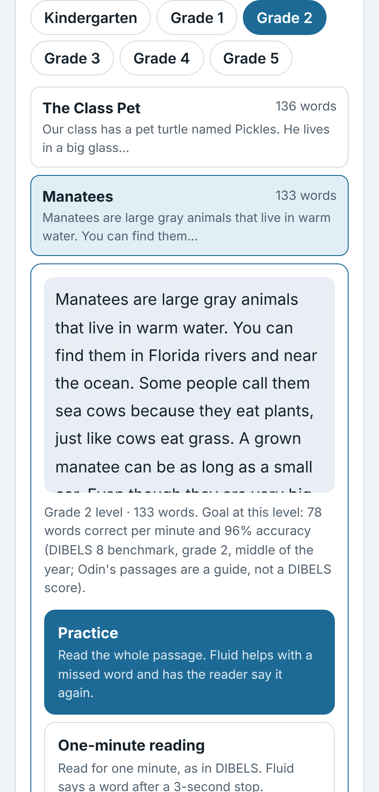
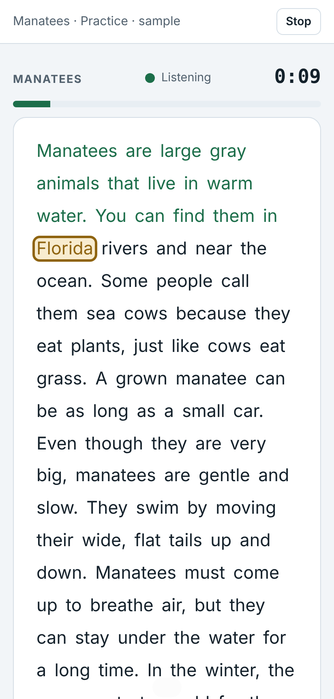
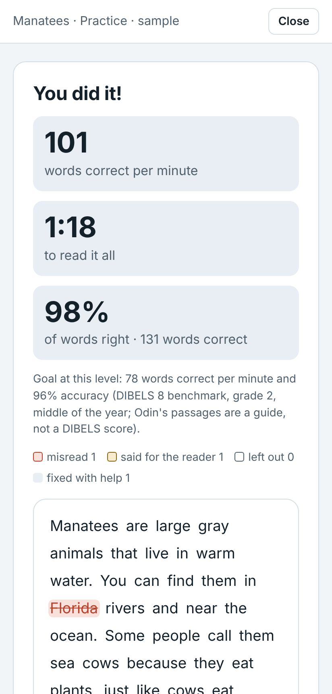

# Fluid

**Fluency reading practice.** A student reads a passage out loud. Fluid listens on the device, says a word when the
reader is stuck or misreads it, has the reader say it again, praises, and shows **words correct per minute** and
accuracy. Fluid stands alone: no sign-in and no server, and **nothing about readers is kept**.

- **Web version:** <https://purpleninjaradish.github.io/Odin-2/fluid/>, and <https://purpleninjaradish.github.io/Fluid/> once
  GitHub Pages is turned on here (Settings › Pages › Source: GitHub Actions)
- **Android app:** [fluid-android.apk](https://github.com/PurpleNinjaRadish/Fluid/releases/latest/download/fluid-android.apk)
  (the latest build that passed its emulator check; Android 12 or newer for the microphone)

Version 0.1.0-alpha. Its passages, scoring and reading screen come from [Odin](https://github.com/PurpleNinjaRadish/project-cerabus)'s
fluency practice (Project Cerberus), version 0.10.0 (see `odin/SOURCE.json`).

## Using it

1. **Choose a level** (kindergarten to grade 5) and a passage. Odin's 36 passages are there, six per level, about 45
   words at kindergarten to 225 at grade 5.
2. **Practice:** the reader reads the whole passage out loud. Words read turn green. When the reader misreads a word or
   stops for 2 seconds, Fluid says the word ("Look again. It says *dish*. Say *dish*.") and listens for the reader to say
   it back, up to three tries, then praises and goes on. A skipped line sends the reader back to it.
3. **One-minute reading:** like a DIBELS 8 oral reading fluency check: one minute, and Fluid says a word after a
   3-second stop. The score is words correct per minute and accuracy, with the DIBELS 8 benchmark for that grade and time
   of year as a guide (Odin's passages are not DIBELS passages).
4. **The score** shows the time, words correct per minute, accuracy, and the passage with each misread word, word said
   for the reader and word left out marked. **Read it again** to beat the best of the session.
5. **Watch a sample reading** shows how it works with a pretend reader, without the microphone.

### The microphone

Fluid listens only with a speech recognizer that works **on the device**, so a reader's voice never leaves it and nothing
is recorded. Without one, Fluid never turns the microphone on.

- **Android:** the Fluid app uses Android's on-device recognizer (Android 12 or newer with Google's speech services).
  The first time, Android may need its English speech pack: Fluid asks for it (**Get the speech pack**).
- **A computer or Chromebook:** a current Google Chrome, which can recognize speech on the device. Press **Check this
  browser**, then **Get the speech pack** if Chrome asks.
- Chrome on an Android phone can't keep speech on the device: use the app there.

### New passages, written with AI

Under **New passages**, write a passage with AI (pick the level, a story or informational text, and a topic) or type or
paste one. Fluid writes numbers as words and warns about titles like Mr. or Dr. and symbols, so the recognizer and the page
agree. Read it, change anything, and save it: it joins its level's list on this device.

The AI is yours to choose, under **AI settings**:

| AI | Cost | Notes |
| --- | --- | --- |
| Ollama or LM Studio, on a computer at school | Free | Private: nothing leaves the school. A page on the internet can reach Ollama only if Ollama allows it (`OLLAMA_ORIGINS`) |
| Google Gemini, Groq, OpenRouter (free models) | Free, with daily limits | A free key from the service |
| Claude, OpenAI | Paid | A key from the service |
| Another service like OpenAI's | Varies | Its address, model and key |

The AI is told only the level, the kind of text and the topic. A key you type is kept only while Fluid is open; it's never
saved. In the Android app, the app makes the call, and the AI's address must start with `https://`.

## Privacy

- Speech is recognized on the device only; the voice is never sent anywhere or recorded.
- Fluid never asks who is reading. The readings of a session (the table **Readings so far**) are in memory only and go when
  Fluid closes.
- Fluid keeps, on the device, only the passages you add and which AI you chose (never a key).
- The Android app's page is built into the app; the app reaches the internet only for an AI you choose.

## How it is built

| Folder | What's there |
|---|---|
| `odin/` | Odin's passages and scoring (`fluency_passages.js`, `fluency.js`), its AI helpers (`ai.js`), its Android speech shim (`android.js`), the reading screen's styles (`fluency.css`) and fonts: **copied from Odin and never edited here** (`tools/sync_odin.py`) |
| `web/src/` | Fluid's page: `fluid.js` (choosing a passage, the reading screen from Odin's Fluency tab, new passages and the AI), `fluid.css`, `head.html` |
| `web/build.py` | Builds `dist/index.html` (GitHub Pages) and the copy inside the Android app |
| `web/tests/test_fluid.py` | Page tests: a sample reading, practice and a one-minute reading with a stand-in recognizer, new passages with a stand-in AI (`fake_ai.py`), and nothing kept |
| `android/` | The Android app: `MainActivity` (the built-in page, the microphone) and `FluidBridge` (Odin's on-device speech bridge, and the AI) |
| `android/ci/` | The emulator check: the bridge, Android's speech and voice, a sample reading and the AI through the app |

Build: `python3 web/build.py` (Python 3.9+). Test: `python3 web/tests/test_fluid.py` (Playwright and Chromium).
The app: `cd android && ./gradlew assembleRelease` (JDK 17, Android SDK), or let GitHub build it
(`.github/workflows/android.yml`: the app and the emulator check go on the `android-build` branch, and the app on the
`latest` release). The test key in `android/keys` signs these builds; for a school or district, build with its own key
(`FLUID_KEYSTORE`, `FLUID_KEY_ALIAS`, `FLUID_KEY_PASS`).

**Keeping Fluid in step with Odin.** When Odin's fluency passages, scoring, AI helpers or speech shim change, run
`python3 tools/sync_odin.py /path/to/project-cerabus`, rebuild and test, and commit. The reading screen in `fluid.js`
comes from Odin's `page-src/src/ui_fluency.js`: bring over changes to how Odin listens and helps.
